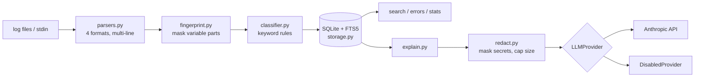

# ai-log-analyzer

A command-line tool that reads logs in several formats, groups repeated errors, classifies them, makes them searchable, and can ask an LLM to explain an error group in plain language.

## Problem

When something breaks, an engineer faces thousands of log lines in different formats. The same failure repeats with different ids, addresses and numbers, so it is hard to see that fifty lines are one problem. Stack traces are spread across many lines. Searching means `grep` and guesswork.

This tool turns mixed logs into one structure, collapses repeats into **error groups**, labels each group with a category, and lets you search and filter. For a group you do not understand, `logan explain` asks a language model, after masking sensitive values.

The design rule is **rules first, AI second**. Parsing, grouping, classification and search are deterministic and fully tested. The model only explains, and it is optional: without an API key everything else works.

All sample logs in this repository are invented.

## Features

- Four log formats: Python/`logging` text, JSON lines, syslog, and web-server access logs.
- Multi-line records: a stack trace stays attached to the line that caused it.
- Error grouping: variable parts (ids, IPs, numbers, paths, emails) are masked, so repeats become one group.
- Rule-based classification into categories such as `timeout`, `database`, `network`, `authentication`, `out_of_memory`, `disk`, `server_error` and `crash`.
- Full-text search (SQLite FTS5) combined with filters for level, source, category and time range.
- AI explanations through Anthropic Claude, behind a provider interface.
- Redaction of credentials, tokens, emails and IP addresses before anything is sent to the model.
- API key read only from the environment and held in a wrapper that cannot be printed by accident.
- Re-ingesting the same file is a no-op (matched by content hash).
- Standard library only. There is nothing to install.

## Technology stack

| Technology | Why |
|---|---|
| Python 3.10+ | Readable, and everything needed is in the standard library. |
| SQLite with FTS5 | A single-user tool needs no server. Full-text search and indexes are built in. |
| `urllib` | One HTTPS call to one fixed address. No SDK to trust or update. |
| `argparse` | A small CLI with no extra dependencies. |
| Frozen `dataclasses` | Immutable data that is easy to test. |
| `unittest` | Ships with Python, so the tests run anywhere with no key and no network. |
| ruff and mypy (dev only) | Lint, formatting and strict type checking in CI. |

## Architecture



| Module | Responsibility |
|---|---|
| `parsers.py` | Recognises each format. A line that matches none is a continuation of the previous record. |
| `timeparse.py` | One explicit timestamp reader, so behaviour is identical on every Python version. |
| `fingerprint.py` | Turns a message into a template and a 12-character hash. |
| `classifier.py` | Keyword rules, ordered most-specific first. |
| `storage.py` | SQLite schema, atomic ingest, search, grouping. All user values are bound parameters. |
| `ingest.py` | Reads files with size limits and stores them. |
| `redact.py` | Masks secrets and caps the prompt size. |
| `llm.py` | The provider interface, the Anthropic provider, and the disabled provider. |
| `explain.py` | Builds the prompt for one group and calls the provider. |
| `config.py` | Reads the environment. Holds the API key in `Secret`. |
| `cli.py` | The `logan` command. |

### Design decisions

- **Grouping uses only the first line.** Later lines of a stack trace differ every time and would make every crash look unique.
- **Classification looks at the first line, not the whole trace.** A `KeyError` deep inside a crash must not relabel the crash as "validation".
- **Redact, then truncate.** Cutting first could split a secret in half and send part of it.
- **The model name is not built in.** Model names change. `ANTHROPIC_MODEL` must be set, and a missing value is a clear error.
- **The request URL is fixed.** It cannot be redirected by a setting, so the key can only be sent to Anthropic.
- **The prompt treats the log as data.** The system prompt tells the model not to follow instructions that appear inside the logs.
- **Atomic ingest.** A file is stored in one transaction. If reading fails half-way, nothing is kept.

## Installation

```bash
git clone https://github.com/FahisJ2k5/ai-log-analyzer.git
cd ai-log-analyzer
pip install -e .
```

Python 3.10 or newer. There are no runtime dependencies. You can also run it without installing: `python -m log_analyzer ...` with `src` on `PYTHONPATH`.

## Usage

```bash
logan ingest samples/app.log samples/access.log samples/syslog.log samples/app.jsonl --year 2026
logan stats
logan errors --level WARNING                       # grouped, most severe first
logan search --text "timed out" --level ERROR      # full-text search plus filters
logan search --since 2h --category database        # relative times: 30m, 2h, 7d, 1w
logan errors --json                                # machine-readable output
cat app.log | logan ingest -                       # read standard input
```

`--year` matters only for syslog, whose lines carry no year. It defaults to the current year.

### Explaining an error group

```bash
export ANTHROPIC_API_KEY="..."          # your own key; never commit it
export ANTHROPIC_MODEL="..."            # a model name from Anthropic's documentation
logan errors                            # copy a fingerprint from the first column
logan explain da2eed99634c
```

Without a key, `logan explain` stops with `error [llm_disabled]` and every other command keeps working.

### Configuration

| Variable | Meaning |
|---|---|
| `ANTHROPIC_API_KEY` | Optional. Enables `logan explain`. |
| `ANTHROPIC_MODEL` | Required when a key is set. |
| `LOG_ANALYZER_DB` | Database file. Default `./log_analyzer.db`. |
| `LOG_ANALYZER_LLM_TIMEOUT` | Seconds to wait for the model. Default 30, maximum 300. |

### Categories

`out_of_memory`, `disk`, `authentication`, `timeout`, `database`, `network`, `server_error`, `not_found`, `configuration`, `validation`, `performance`, `crash`, `unclassified`, and `info` (anything below WARNING).

## Security

- **Secrets.** The API key lives only in the environment and in a `Secret` object whose `repr` and `str` are masked. A test checks that the key never appears in output, errors, or the provider's text form.
- **No key in the source.** A test scans the source for strings shaped like real keys.
- **Before text leaves your machine.** `redact.py` masks key=value credentials, Authorization headers, bearer tokens, JWTs, well-known API key shapes, private-key blocks, passwords in URLs, emails and IP addresses. The prompt is capped at about 4,000 characters.
- **SQL injection.** Every user value is a bound parameter. Search text becomes a quoted FTS5 query, so quotes, `AND`, `NEAR(` and `*` are plain words. Tests try these directly.
- **Resource limits.** Files over 200 MB, binary files, and lines over 20,000 characters are rejected or cut. A single record is capped at 10,000 characters.
- **Limits of redaction.** It is pattern matching. It will miss secrets with an unusual shape and can mask harmless text that looks like one. Do not send logs that must never leave your environment.

## Screenshots

*Placeholder: add a terminal screenshot of `logan errors --level WARNING` here.*

## Testing

```bash
python -m unittest discover -s tests -t . -v
```

No network and no API key are needed. A fake provider stands in for the model.

| File | What it covers |
|---|---|
| `test_parsers.py` | Each format, multi-line records, time zones, bad input, random garbage. |
| `test_analysis.py` | Grouping, classification, and redaction of every secret shape. |
| `test_storage.py` | Atomic ingest, duplicates, search, filters, paging, grouping, SQL-injection attempts. |
| `test_llm.py` | The provider, secret handling, what gets sent to the model, and the CLI end to end. |

### Verification status

| Check | Status |
|---|---|
| 128 tests | Passed on Python 3.10 (development sandbox) and 3.14.2 (GitHub Codespace). |
| Deliberate-bug check | Ten bugs were introduced one at a time (redaction after truncation, a removed email mask, unquoted search text, SQL built from a filter value, stack traces not joined, grouping on the whole message, a wrong time boundary, the key shown in a repr, duplicate files stored, redaction skipped). The tests caught all ten. |
| Real Anthropic API call | **Not run.** It needs a real key and model name. The request format is tested against a fake transport only. |
| Python 3.10, 3.11 and 3.12, ruff, mypy | Passed in GitHub Actions (CI run #1, commit 806d0a1). ruff and strict mypy also passed in the Codespace. |

## Limitations

- Classification is keyword-based, not a trained model. Unusual wording ends up `unclassified`.
- Syslog has no severity or year, so the level is a keyword guess and the year is supplied.
- A timestamp with no time-zone offset is assumed to be UTC.
- Only the four formats above are recognised. Anything else is kept as `UNKNOWN`-level text attached to the previous record.
- The LLM can be wrong. Treat explanations as a starting point.
- There is a command-line interface only. There is no REST API or web interface yet.

## Future improvements

- A FastAPI layer over the same storage and search code.
- Time-bucketed error counts (errors per hour) to show spikes.
- A second LLM provider behind the same interface.
- More log formats (for example logfmt and Kubernetes container logs).
- Streaming ingest of a file that is still being written.
